# Raven


## Overview

<div>
<a href="https://apps.apple.com/us/app/raven-documents/id6752484174?mt=12">
  
</a>
<a href="https://apps.apple.com/us/app/raven-documents/id6752484174?mt=12">
  
</a>
</div>

Raven is an on-device document assistant for iPhone and Mac. You add PDFs, photos, audio, or video to a chat, then ask questions and get summaries based on those files.

All processing runs locally with Apple Foundation Models. Nothing is sent to a server or cloud service.

## Features

* Chat about your documents on iOS and macOS
* Extract text from PDFs, images, audio, and video
* Answers and summaries grounded in the files you added
* A sources panel so you can see what each chat is using
* Photo stacks in a conversation, with a full-screen viewer
* Search across chats and inside a conversation
* A custom shape and color for each chat
* Attach a file, photo, or camera shot from the chat
* On Mac: a sidebar, menu bar commands, and a command palette
* On iPhone: swipe a message to see when it was sent
* Projects keep your files organized on device

## Screenshots

### iOS

| Chat list | Answers | Photos |
|:---:|:---:|:---:|
| 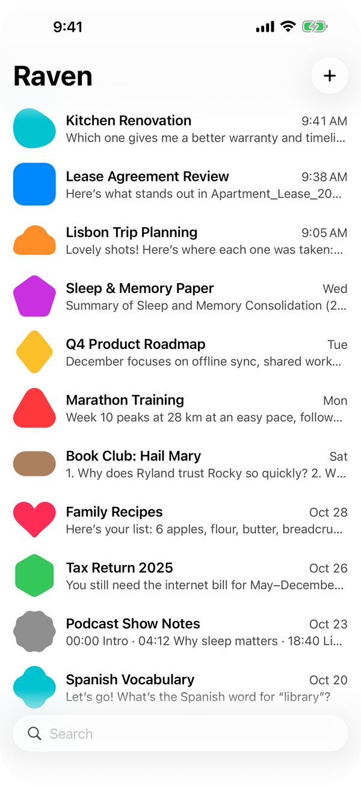 |  |  |

| Image viewer | Typing | Sources |
|:---:|:---:|:---:|
|  | 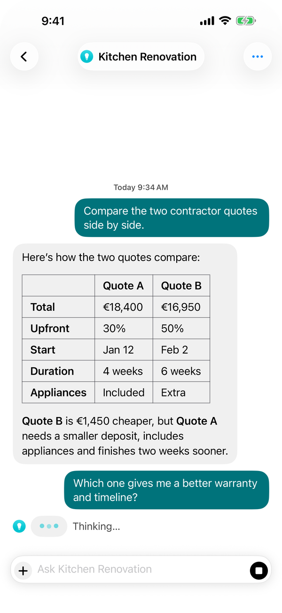 |  |

| Search | New chat | Summary |
|:---:|:---:|:---:|
| 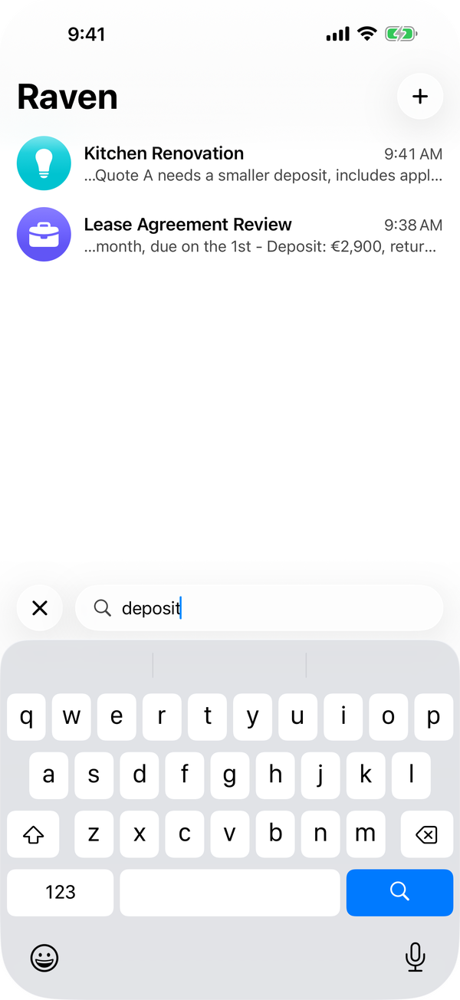 | 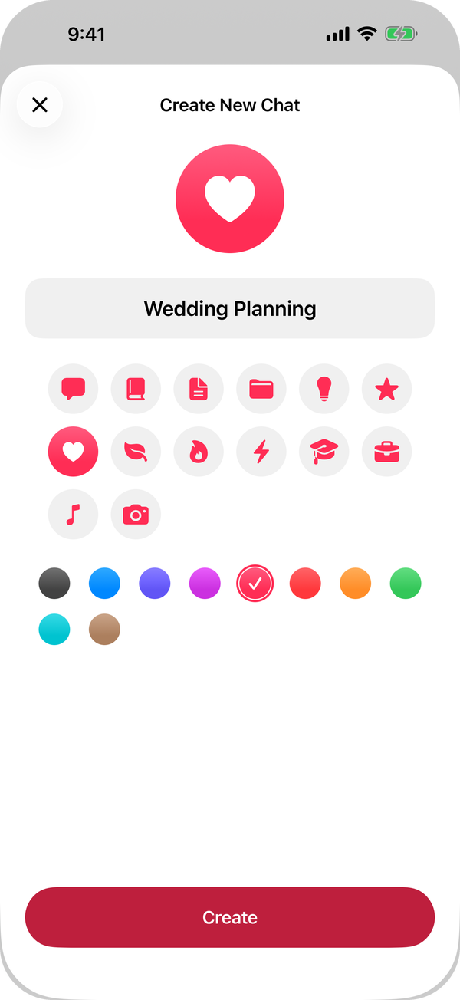 | 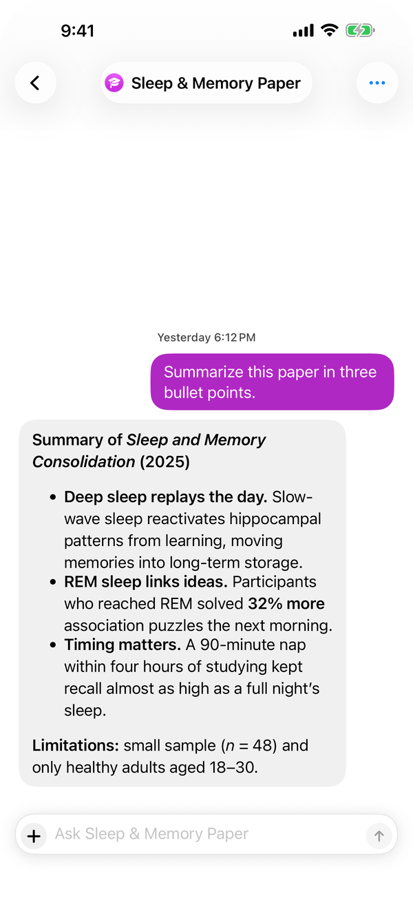 |

Dark mode

| Chat list | Answers | Photos |
|:---:|:---:|:---:|
| 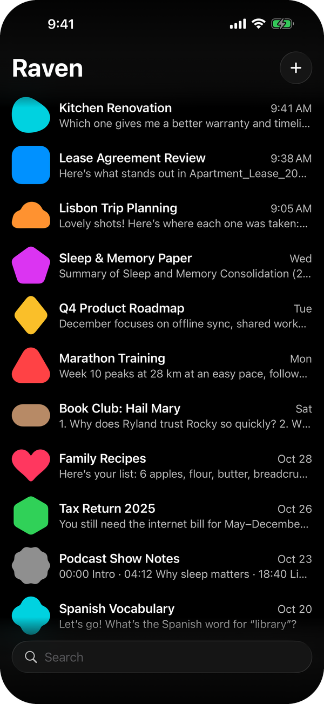 | 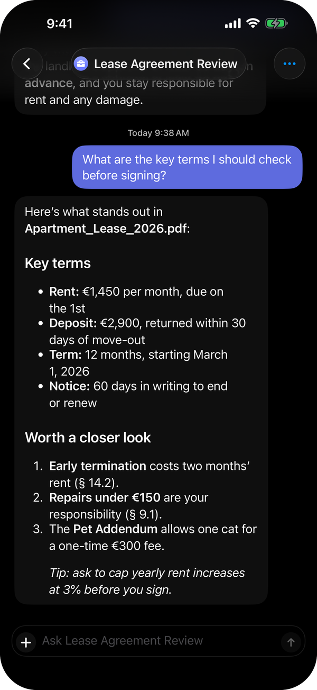 |  |

### macOS

Chat and sources

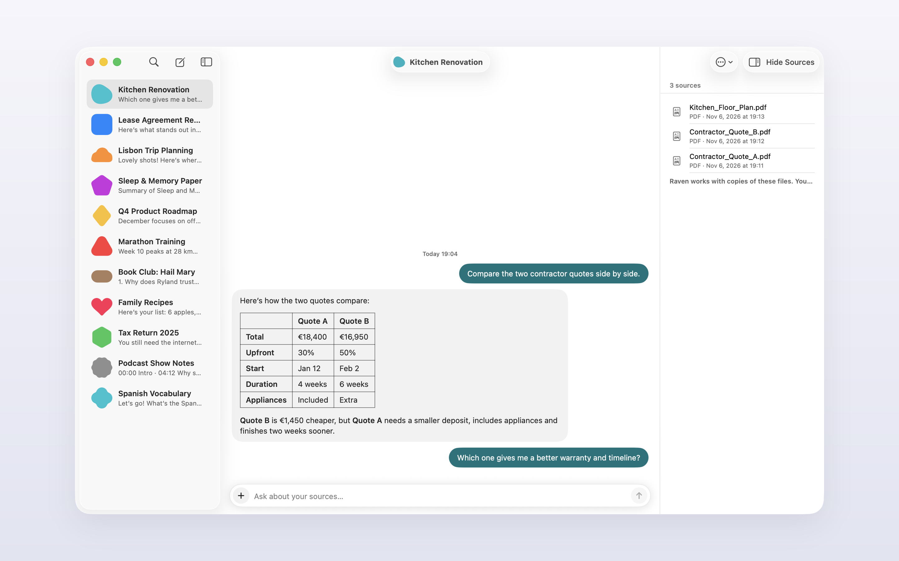

Dark mode

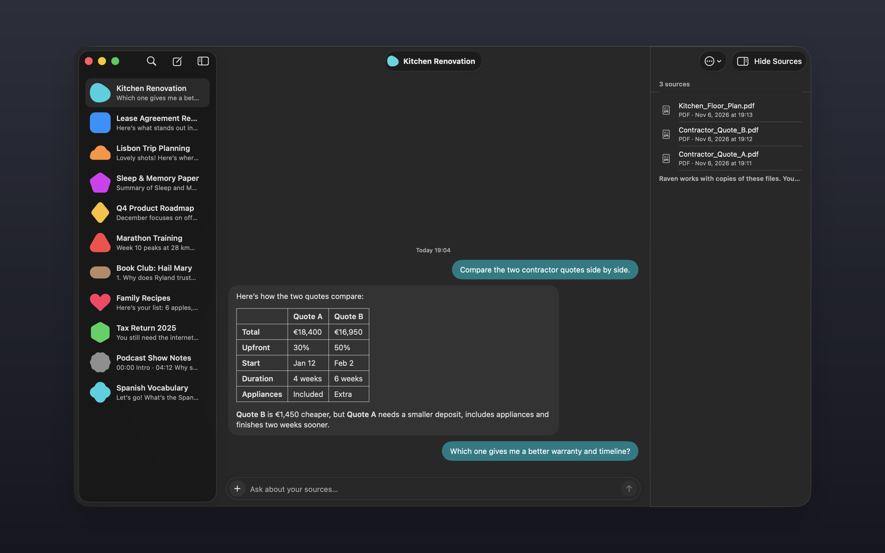

Photos

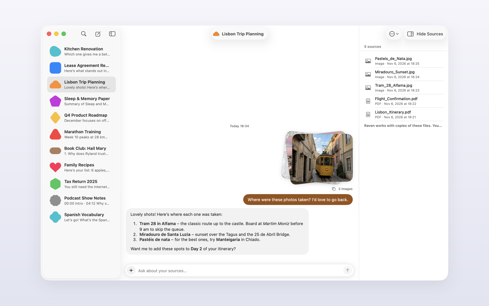

Document review

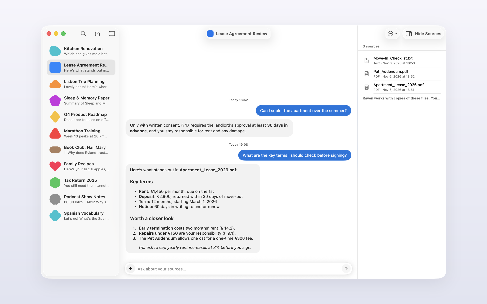

## Privacy

* All data stays on your device
* AI features do not need an internet connection
* You keep full control over your documents

## System Requirements

* iOS 26 or later
* macOS 26 Tahoe or later
* Xcode 26 to build from source
* A device that supports Apple Foundation Models

## Quick Start

1. Download Raven from the App Store, or clone this repository
2. To build it yourself, open the project in Xcode 26
3. Run it on iOS 26 or macOS 26 Tahoe

### Add content

1. Create a new chat
2. Add files. They are copied to Documents/Raven Projects

### Ask questions

1. Open a chat
2. Type a question. Raven answers from the files in that chat

## Project Structure

```
Documents/
  Raven Projects/
    YourProjectName/
      public/
        [uploaded files]
```

## Development Status

This project is in active development.

## Contributing

* Report issues
* Suggest features
* Submit pull requests

## Dependencies

* GRDB.swift
* Apple Foundation Models
* Vision
* Speech
* PDFKit
* AVFoundation

## License

This project is open source. Please check the LICENSE file for details.

## Support

Open an issue with your macOS or iOS version and the steps to reproduce the problem.

## Author

Created by [Eldar Tutnjic](https://github.com/31d4r)
